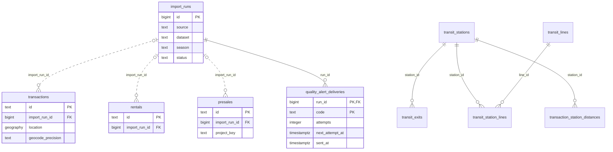
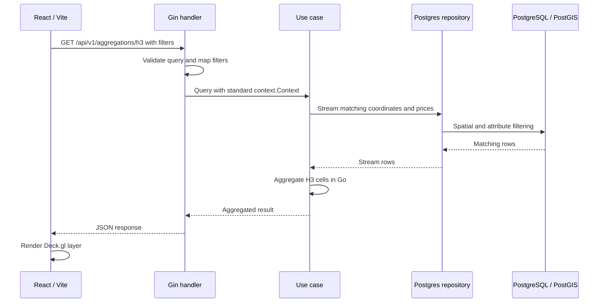

# Architecture

<picture>
  <source media="(prefers-color-scheme: dark)" srcset="docs/architecture/architecture-dark.png">
  
</picture>

[互動版](docs/architecture/README.md) · [匯入與告警流程](docs/DATA_IMPORT.md) · [API](docs/API.md)

## 核心資料關係

外鍵節選；完整結構見 [migrations](migrations/)。

交易的 `import_run_id` 可為 NULL；交易與車站距離表的 `transaction_id` 僅是邏輯關聯，未畫成外鍵。

## H3 查詢流程

H3 在 Go 聚合；行情與區域比較主要由 SQL 彙總。Mock 不走此流程。

## 必要限制

- 已持久保存 processed data；raw 保存、重播與完整欄位級 lineage 尚未實作。
- 總覽是功能責任圖，非正式部署拓撲；公開環境預設不啟動同步。見 [存取邊界](docs/ACCESS_BOUNDARY.md)。
- Webhook 可能重送；資料缺口不等於零交易。見 [品質與匯入說明](docs/DATA_IMPORT.md)。
- 區界為近似值、距離為直線距離；研究指標不是未來報酬預測。
