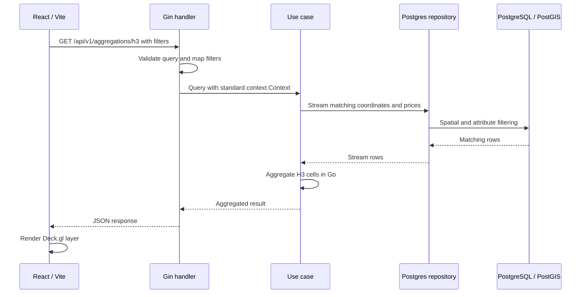
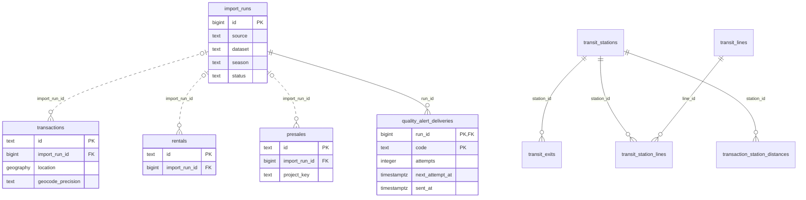

# GeoProphet Architecture

## Overview

Web 和 API 放在同一個 monorepo，但可以分開部署。React 負責地圖與互動；Gin 處理查詢規則和資料庫存取，提供 H3 聚合與單格明細、趨勢、摘要、多年行情分析、行政區比較、地點搜尋、交易動態、CSV 匯出及軌道站點行情。

## 架構圖

<picture>
  <source media="(prefers-color-scheme: dark)" srcset="docs/architecture/architecture-dark.png">
  
</picture>

[開啟互動圖](docs/architecture/README.md)

## Components

- **Web**：React 19、Vite、MapLibre（底圖與相機）、Deck.gl（`MapboxOverlay` 疊加圖層）、Recharts。
- **API delivery**：Gin handlers、query validation、CORS、request ID、error mapping。
- **Use case**：框架無關的成交查詢、H3 aggregation 與單格明細、市場摘要、行情分析、行政區比較、站點行情、地點搜尋、交易動態與 filter validation。
- **Infrastructure**：PostgreSQL/PostGIS repository，以及可重現的 mock repository。
- **Database**：成交資料、門牌坐標、匯入紀錄、PostGIS geography point 與查詢 indexes。

操作文件列在 [docs/README.md](docs/README.md)。API 規格見 [docs/API.md](docs/API.md)，匯入流程見 [docs/DATA_IMPORT.md](docs/DATA_IMPORT.md)。

## Data flow

1. 使用者移動地圖（MapLibre `moveend` 回報可視範圍）或修改價格、坪數、建物型態、視圖、H3 resolution。
2. 前端等待 250ms，取消過期請求並呼叫 API。
3. Gin handler 驗證 query string，轉換成 `TransactionFilter`，預設套用近 12 個月並排除特殊交易。
4. Use case 呼叫 repository：點位與 H3 排除只定位到行政區中心的成交；H3 從 PostgreSQL 逐筆串流，在 Go 聚合全部符合條件的成交；月份趨勢與市場摘要由 SQL 聚合計算。
5. 前端只取得當前視圖需要的 points 或 hexagons，Deck.gl 負責渲染；摘要則更新目前篩選範圍的統計卡片。

地點搜尋走獨立流程：前端送出至少 2 字的文字，use case 正規化城市、行政區與地址，repository 再從 `address_points` 查詢門牌或道路中心；行政區結果以該區門牌坐標的中心點定位。

交易動態共用成交篩選，額外加入縣市、行政區、本期新增與排序條件；repository 使用排序值加交易 ID 的 keyset cursor，每頁回傳 50 筆。CSV 匯出重用相同查詢並逐列串流，最多輸出 50,000 筆，避免在 API 記憶體累積完整結果。

行情分析共用價格、坪數、建物型態與特殊交易篩選，預設查近 5 年。PostgreSQL 分別聚合月度走勢、建物型態／屋齡／坪數分組與單價區間；use case 依匯入涵蓋日期標記尚未完整登錄的月份。React 行情分析頁及其圖表均以 lazy chunk 載入。

行政區比較以 `city_code` 與 `district` 分組，排行涵蓋所選縣市全部有成交的行政區，月度走勢僅查最多 4 個選定行政區。年增率另比較最近完整登錄的 12 個月與前 12 個月，避免近期資料揭露延遲扭曲比較。前端頁面與圖表各自 lazy 載入；比較頁的區域著色圖使用由門牌坐標推算的近似行政區邊界，不使用交易點推估界線，也不視為法定界線。

區域投資觀察採單一建物類型、半開坪數／屋齡區間形成同類樣本。由各縣市成功匯入的期別推算最後完整月份，在 PostgreSQL 一次掃描兩段各 12 個月的住家用房地成交，`ROLLUP` 同時計算各行政區與全市的每坪單價中位數及筆數。沒有足夠樣本的價格與變化率回傳 `null`，前端不以歷史漲跌推斷未來，也不把成交量稱為去化速度。

投資比較工作台由獨立 use case 對齊買賣與租賃共同完整的 12 個月，在 PostgreSQL 以同縣市、屋型、坪數與屋齡取得兩組樣本；成交至少 30 筆、租約至少 20 筆才計算區域中位數的毛租金比。成本情境在瀏覽器計算，輸入不傳至 API 或保存。

區域流動性研究沿用同類住宅篩選，repository 一次按行政區與交易月份聚合 24 個月成交量。use case 補齊月序列，另以 `import_runs` 成功期別檢查各交易月首日至月底加 90 天的登錄匯入涵蓋。活躍月份、連續零成交間隔與前後期量變化均受樣本與涵蓋門檻控制；缺口月的筆數仍保留為觀察值。前端在投資頁最多比較 3 區，以共用縱軸的 SVG 月度柱狀圖、缺口斜線及月表呈現，隨投資頁的 lazy chunk 載入，不增加圖表套件依賴。

單一地址估價在 PostgreSQL 以 GiST 索引取出 1 公里內的候選成交與全市房價指數，權重、加權中位數與信心等級在 use case 計算；參數與信心區間來自離線回測，寫成常數並在 API 文件說明。

租金與毛報酬率以同一方式取最近 12 個完整月份（買賣與租賃都完整登錄者），分別對 `rentals` 與 `transactions` 做 `ROLLUP` 中位數，再於 use case 合併並以 20 筆為門檻計算毛報酬率。租賃只取整戶出租的新簽、非特殊租約，預設排除社會住宅。

地圖蜂巢卡按需查詢單格的常見地點、屋齡組成與單價年增率；軌道圖層按需讀取 TDX 匯入的路線與站點，車站卡另查 300／500／800 公尺成交統計和多年走勢。行政區輪廓由 API 提供；生活圈示意範圍只存在前端靜態資料，不屬於資料庫中的行政區邊界。

H3 查詢的呼叫順序：



## Frontend loading strategy

- `Map` 與 `TrendChart` 透過 `React.lazy` 建立獨立載入邊界，載入期間使用固定高度 fallback，避免版面跳動。
- 地圖與圖表各自打包成 lazy chunk，主介面可以先顯示，再載入較大的 MapLibre、Deck.gl 與 Recharts 程式碼。
- mock adapter 以 dynamic import 載入，正式 API 模式不會在首屏下載 mock H3 計算程式。
- Vite `manualChunks` 將 React、MapLibre、Deck/WebGL、H3、charts 與一般 vendor 分離，改善首屏傳輸與長期快取；MapLibre 與 Deck runtime 仍是最大的延遲載入 chunks。

## Package boundaries

```text
api/cmd/server                 composition root and shutdown
api/internal/domain           entities and value objects
api/internal/usecase          business rules and repository ports
api/internal/delivery/http    Gin router, handlers and DTO boundary
api/internal/infra/mock       deterministic local adapter
api/internal/infra/postgres   pgx/PostGIS adapter
api/cmd/importer               data import CLI (door-number coordinates, 實價登錄 sales, rail stations)
api/internal/importer         import use case, store and fetcher ports, import_runs audit
api/internal/lvr              實價登錄 open data parser, normalization and outlier flags
api/internal/addresspoint     door-number coordinate parser, TWD97 → WGS84, per-city sources
api/internal/geocode          address parser and offline matcher with precision fallbacks
api/internal/opendata         data.gov.tw and 實價登錄 download client
api/internal/transit          TDX client, rail stations and lines, transfer-station merge, opening dates
api/internal/twtext           Traditional Chinese text normalization
```

## Import pipeline

1. `importer addresses` 透過 data.gov.tw API 找出縣市最新的門牌坐標 CSV，合併同門牌的各樓層、將 TWD97 TM2 轉成 WGS84，整批取代 `address_points` 中該縣市的資料。
2. `importer sales` 下載一季實價登錄 zip（約 15MB，於記憶體中讀取），逐縣市解析買賣主檔、標記特殊交易與極端價格。
3. 以該縣市的門牌點建立記憶體索引，依序嘗試門牌、同巷弄最近門牌、路段中心、行政區中心定位。實價登錄以 Unicode 私用區字元表示難字，比對路名時視為萬用字元，且只接受唯一候選。
4. 透過 COPY 寫入 staging table，再以「編號」upsert 到 `transactions`（租賃則為 `rentals`）；每個縣市、每個資料集一筆 `import_runs` 紀錄。
5. `importer sales -current` 匯入每 10 日一期的本期資料，依 `build_time.xml` 的登記期間決定所屬季別；之後同一季的季資料會以「編號」覆寫它。
6. `importer sync` 以 `import_runs` 判斷哪些工作已完成：門牌坐標超過 30 天才更新、季資料由進行中的季往回找第一個已公布者、本期資料以登記期間為 key。加上 `-interval 24h` 時常駐執行，失敗會記錄並於下次重試。
7. `importer transit` 從 TDX 下載軌道站點、出入口與路線，合併轉乘站後整批取代 `transit_*` 資料表，並重算每筆交易到 800 公尺內各站最近出入口的距離（`transaction_station_distances`）。之後的 upsert 在同一交易中重算受影響交易的距離。`sync` 每 7 天更新一次，沒有 TDX 金鑰時略過。

Delivery layer 不得將 `gin.Context` 傳入 use case；repository 接收標準 `context.Context`，讓取消與 timeout 能傳到 pgx。

## Data engineering boundary

資料匯入與 API 查詢分開處理，但目前共用 Go module 和 PostgreSQL。`cmd/importer` 負責下載、解析、定位及寫入；API 讀取處理後的資料，後台 API（`/api/v1/admin/*`）另讀取 `import_runs`、交易概況、資料庫用量與備份目錄。

後台只接受 `tailscale serve` 標頭中、列於 `ADMIN_LOGINS` 的 Tailscale 帳號。觸發的工作寫入 `admin_jobs` 佇列，API 本身不執行匯入。常駐 importer 與備份服務每 15 秒以 `FOR UPDATE SKIP LOCKED` 認領各自的工作並記錄結果；部分唯一索引限制同一種工作同時只能有一筆待執行。

公開 Compose 不啟動常駐 importer 與備份服務，`ADMIN_LOGINS` 也固定為空；管理端的設定見 [存取說明](docs/ACCESS_BOUNDARY.md)。

資料品質由 `import_runs` 的期別、筆數與定位精度計數推導；後台列出各縣市／資料集最新成功匯入與目前觸發的規則。若設定 `QUALITY_WEBHOOK_URL`，常駐 importer 每 5 分鐘檢查一次，將新告警排入 `quality_alert_deliveries`，再以 HTTPS 傳送；送達狀態與退避重試保存在 PostgreSQL。未設定時不對外通知。

生活機能設施由三個來源整批替換：OpenStreetMap 台灣檔以兩次串流讀取（先取線段與所需節點 ID，再取節點座標），政府名單以門牌定位。周邊摘要在 PostgreSQL 以 GiST 索引查詢點位與範圍；機能熱度在 use case 以 H3 聚合範圍內的設施。

預售屋以建案為分析單位：`presales` 逐筆保存，`presale_projects` 由 SQL 函式在匯入時重建，取該案最精確的地址為位置；建案統計、樓層價差與周邊中古屋比較在查詢時計算。

目前 `transactions`、`rentals`、`presales`、`address_points`、`transit_*` 保存的是處理後資料。原始 ZIP／CSV／TDX 回應還沒有長期保存，行情分析也主要在查詢時計算，因此**尚未**建立完整的 raw／processed／analytical 三層。

之後若加入 raw 檔案保存與重播、明細品質檢查，或按查詢需求建立增量彙總，需要保留來源版本與處理批次，才能查回資料的來源。

## Data model

核心 `transactions` 以實價登錄「編號」為主鍵，欄位包括總價、車位價、建物坪數（不含車位）、每坪單價、格局、樓層、建物型態、成交日、特殊交易原因（`is_special` 為 generated column）、`GEOGRAPHY(POINT, 4326)` 與定位精度。位置使用 GiST index，常用篩選欄位使用 B-tree indexes。建物型態篩選以 `建物型態` 括號前的字（住宅大樓、華廈、公寓、透天厝）分類，其餘歸入「其他」。

大眾運輸以 `transit_stations`（合併後的車站）為中心，`transit_station_lines` 記錄各月台所屬路線與通車日期，`transit_exits` 為出入口（GiST index），`transit_lines` 存裁切後的路線。車站周邊行情由 `transaction_station_distances` 以 `(station_id, transaction_id)` 取出，再以 300、500、800 公尺三圈彙總。

社區（`communities`）由成交推算：`transactions`、`rentals` 的 `community_key` 是由地址、建物型態與完工日算出的 generated column，匯入時以 `refresh_communities()` 重建受影響的社區，再以 `name_communities()` 配上預售建案名稱。社區頁直接以 `community_key` index 取出成交與租約，同行政區比較則走既有的 `(city_code, district)` index。

主要資料表的關係如下，只列部分外鍵；完整定義在 [migrations](migrations/)。交易的 `import_run_id` 可以是 NULL；車站距離表雖有 `transaction_id`，但沒有對交易表設定外鍵，因此圖中不畫這條線。



`district_boundaries` 儲存由門牌坐標推算的 GeoJSON 多邊形，供行政區比較著色圖與地圖輪廓使用；前端生活圈示意多邊形不在資料庫中。

## Non-functional concerns

- **安全**：第三方 API 金鑰只存在後端；前端 bundle 不注入秘密。
- **效能**：成交 endpoint 有 2,000 筆上限；H3 聚合只讀取座標與價格欄位並逐筆串流，避免大量資料一次進入 API 記憶體，但廣域查詢仍需掃描全部符合條件的成交；趨勢、摘要、行情分析與行政區比較在資料庫端聚合；地點搜尋最多回傳 8 筆；交易動態以 50 筆 keyset pagination 載入，CSV 串流上限 50,000 筆。
- **可靠性**：HTTP server 設有 read/write/idle timeout 及 graceful shutdown。
- **可觀測性**：每個請求附 request ID，Gin access log 可用於追查。
- **測試**：use case、handler 與前端 API serialization 分層測試；Go 測試啟用 race detector。

## Tradeoffs

- H3 暫時在 Go use case 聚合，部署簡單且容易測試，但大量資料時不如預聚合表。
- Web/API 放在同一個 repo，方便目前團隊維護，也保留分開部署的能力。
- mock 與 Postgres 共用 repository contract，方便開發，但 mock 不模擬資料庫所有查詢特性。

## Risks and mitigations

- **大型 viewport 回傳過多資料**：累積多年資料後，為 H3 新增預聚合表、materialized view 或 tile API。
- **高頻篩選造成資料庫壓力**：前端 debounce；後續可加 Redis 或 CDN cache。
- **資料來源合法性與一致性**：只使用政府開放資料授權的來源；以「編號」去重，`import_runs` 記錄每次匯入的版本與結果。
- **跨站設定錯誤**：正式部署優先以同一 origin 的 `/api` reverse proxy 對外。
