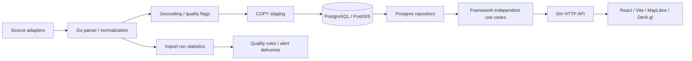

# Architecture

## Responsibility boundaries

來源下載與解析位於 `api/internal/opendata`、`addresspoint`、`lvr`、`transit`、`facility`；排程與工作執行位於 `importer`。delivery 不將 `gin.Context` 傳入 use case，repository 使用標準 `context.Context` 與 pgx，讓取消傳遞至資料庫。

## Data model and lineage

買賣、租賃與預售分別存於 `transactions`、`rentals`、`presales`；`address_points` 和 `transit_*` 提供定位基礎。`import_runs` 記錄批次、來源／期別、成功失敗與寫入統計，`admin_jobs` 是人工工作的佇列，`quality_alert_deliveries` 保留通知與重試狀態。這些紀錄不是完整欄位級 lineage。

目前持久層主要是 processed data；原始 ZIP／CSV／TDX 回應尚未持久保存。`presale_projects` 是匯入時重建的衍生建案資料，其他分析多為查詢時彙總。沒有宣稱完整 medallion 或 lakehouse 架構。

## Reliability and quality

- 實價登錄依來源「編號」upsert；COPY staging 和寫入使用交易，重跑不應增加重複主鍵。
- 定位精度與特殊交易原因保留在資料中，分析採用明確的排除條件。
- 已完成的同步工作依成功期別跳過，失敗留下匯入紀錄並於後續同步重試。
- 工作佇列以 `FOR UPDATE SKIP LOCKED` 認領；部分唯一索引約束待執行工作。
- Webhook 採持久化送達狀態與退避重試，可能重送，接收端應去重，不宣稱 exactly-once。
- 流動性研究補齊月序列並檢查登錄匯入涵蓋；缺口的零筆不是實際市場零交易。

## Backend and visualization

PostGIS geography＋GiST 用於可視範圍和附近查詢，交易清單使用 keyset cursor，CSV 逐列串流且限制最多 50,000 筆。H3 目前在 Go 聚合；區域排行與趨勢主要在 PostgreSQL 彙總。

React 頁面和圖表以 lazy loading 載入，Vite manual chunks 分隔地圖、Deck.gl 與圖表依賴。前端取消過期請求、保留 URL 篩選狀態，並以樣本門檻、缺口斜線與空狀態避免誤讀資料。

## Tradeoffs and next steps

- Go 常駐同步與 PostgreSQL 佇列降低部署成本，沒有引入 Airflow／Kafka；更複雜的依賴 DAG 或高吞吐需求才重新評估。
- 即時 SQL 與 Go H3 聚合容易追溯口徑，但大範圍查詢需掃描較多資料；未來依 benchmark 選擇預聚合表或 tiles。
- raw 檔案保存、來源 checksum、版本化轉換與可重播，屬於下一階段，不能用目前的 upsert 取代。
- 近似行政區邊界不是法定界線，地理距離不是步行距離；投資數據不代表出售機率或未來漲幅。

## Deployment and security

公開 Compose 僅供本機展示：獨立 project／volume、web 綁 loopback、資料庫不發布埠號、預設不啟動背景匯入。管理 API 的可信身分邊界見 [存取邊界](docs/ACCESS_BOUNDARY.md)。CI 僅讀取權限與測試／建置，不持有正式部署或跨 repo 發布憑證。
