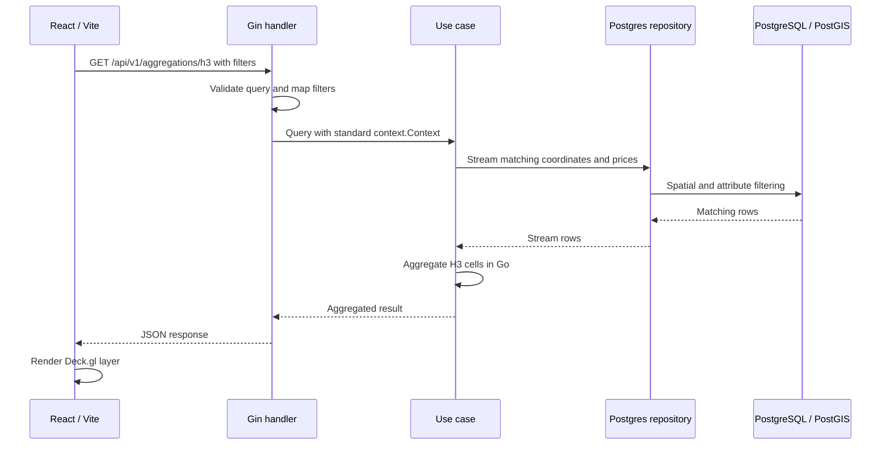

# Architecture

<picture>
  <source media="(prefers-color-scheme: dark)" srcset="docs/architecture/architecture-dark.png">
  
</picture>

[開啟互動圖](docs/architecture/README.md) · [資料匯入與告警](docs/DATA_IMPORT.md) · [API](docs/API.md)

資料表關係

下圖只列部分外鍵。完整的資料表定義在 [migrations](migrations/)。

交易的 `import_run_id` 可以是 NULL。車站距離表雖然有 `transaction_id`，但沒有對交易表設定外鍵，因此圖中不畫這條線。

H3 查詢流程

這是使用資料庫時的 H3 查詢：Go 計算蜂巢統計，行情與區域比較則主要由 SQL 計算。本機 mock 不會走這條路徑。

## 目前沒做的事

資料庫只保存處理後的資料，原始下載檔沒有保存，所以還不能從原始檔重播匯入。`import_runs` 記錄批次結果，不追蹤每個欄位的來源與變更。

## 看圖與數據時要注意

- 圖中是程式之間的關係，不是正式部署配置。本機預設不啟動同步，管理端設定見 [存取說明](docs/ACCESS_BOUNDARY.md)。
- Webhook 可能重送；沒有匯入某個月份，也不代表當月沒有成交。見 [資料匯入](docs/DATA_IMPORT.md)。
- 行政區界線是近似值，車站距離是直線距離。歷史行情不能當作未來報酬。
