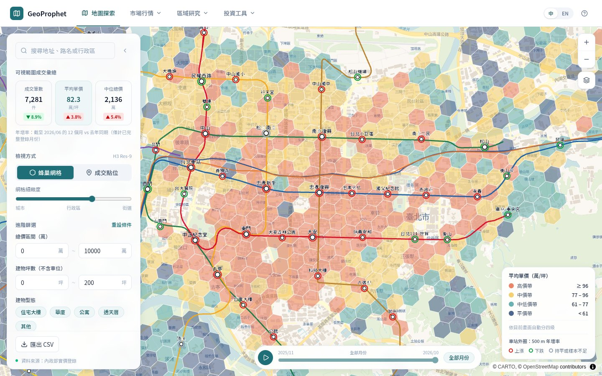
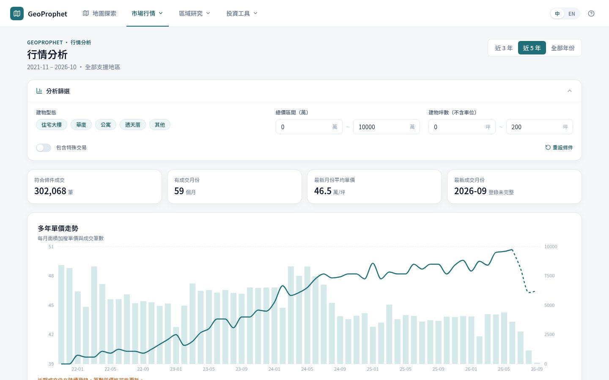
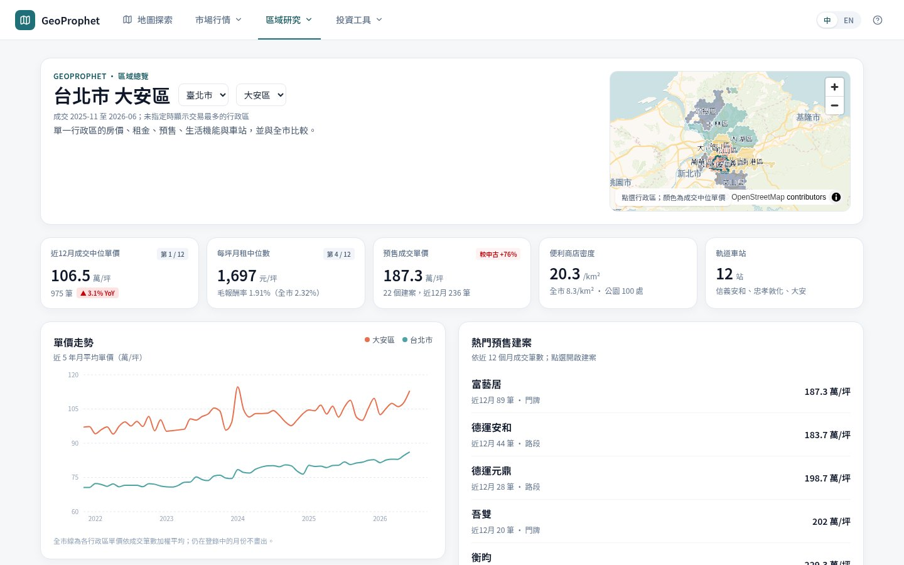
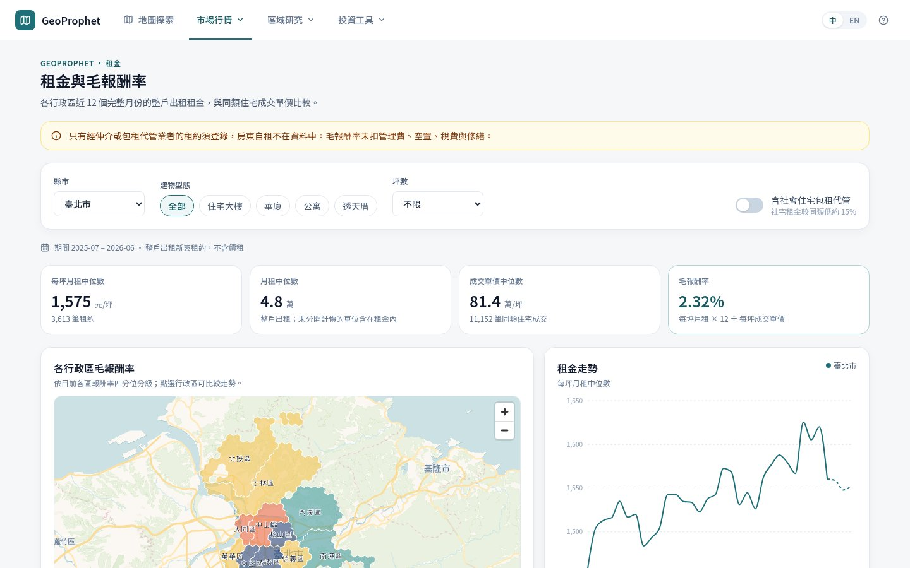
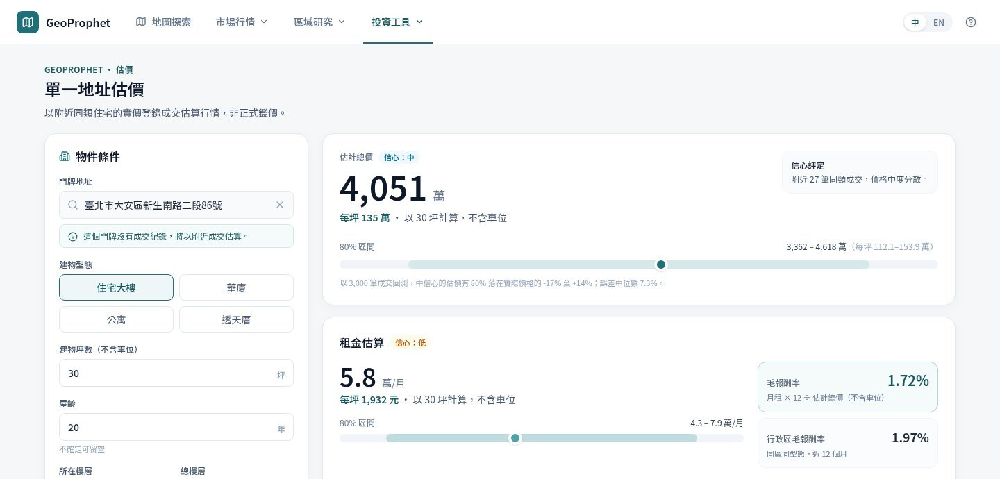
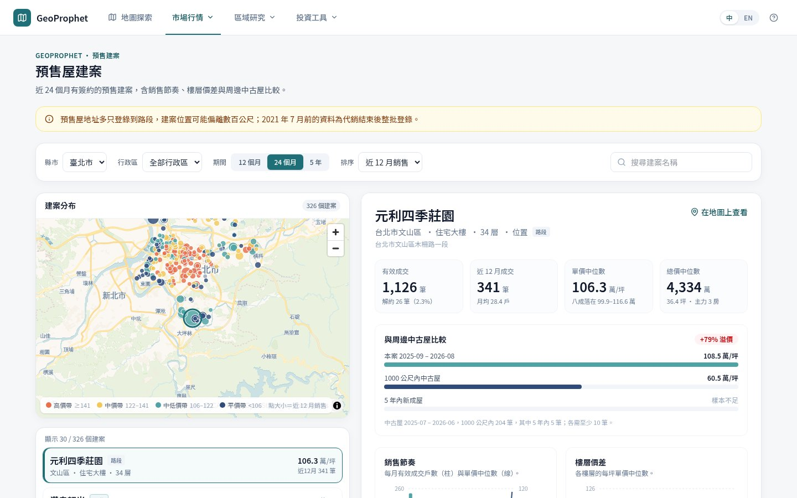
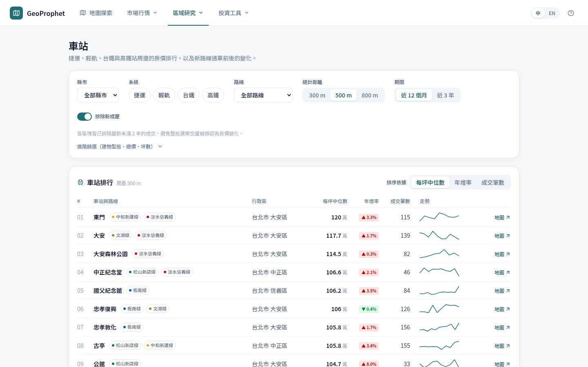
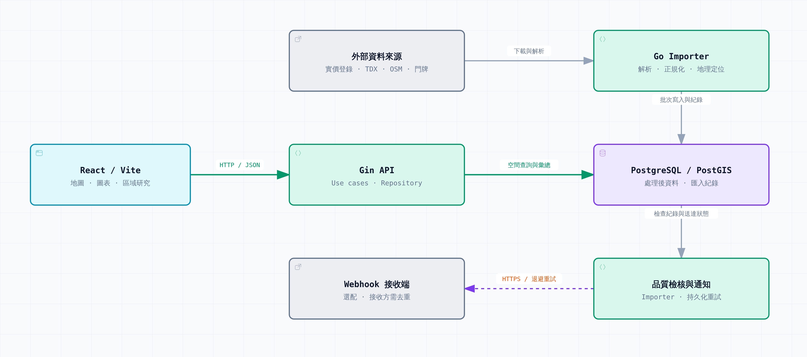

# GeoProphet

[](https://github.com/karevin07/geo-prophet-public/actions/workflows/ci.yml)
[](LICENSE)


[繁體中文](README.md) · [English](README.en.md)

Explore Taiwan's registered sales, leases, and presale transactions alongside address coordinates, rail stations, and nearby facilities. View sales on a map, follow price trends, compare districts, and estimate the price and rent of a single address.

Go downloads and imports the data, PostgreSQL/PostGIS stores and queries it, and React displays maps and charts.



| | |
| --- | --- |
|  |  |
| **Market analysis**: filter by building type, price, and size to see prices and sales over several years. | **Area overview**: one district's price rank, rental yield, presale premium, and facilities per km². |
|  |  |
| **Rents**: whole-unit rents, gross yields, and trends by district. | **Estimate**: price and monthly rent from comparable sales and leases nearby, with backtested 80% ranges. |
|  |  |
| **Presale projects**: sales pace, floor premiums, and the gap to nearby resale homes. | **Stations**: price rankings around MRT, rail, and high-speed rail stations, and changes after new lines open. |

Screenshots come from a local deployment loaded with the official data. The local trial mode below uses synthetic data, so its numbers differ. The interface is in Traditional Chinese, with an English toggle.

<picture>
  <source media="(prefers-color-scheme: dark)" srcset="docs/architecture/architecture-dark.png">
  
</picture>

[Architecture](ARCHITECTURE.md) · [Open the interactive diagram](docs/architecture/README.md). Diagram labels and most supporting docs are in Traditional Chinese.

## Run locally

Install Node.js 24+, npm, and Make, then run:

```bash
npm ci
make dev-web
```

Open <http://localhost:3100>. This mode uses synthetic data, so no database or API keys are needed. The basemap still needs network access. Rental and presale pages may have no data, and CSV export is disabled.

### Use real data

You need Docker with the Compose plugin. These commands start a local PostGIS database and download a year of Taipei (`CITY=a`) transactions plus facility data:

```bash
cp .env.example .env    # set POSTGRES_PASSWORD to a local password
make docker
make import-city CITY=a SEASON=114S3-115S2
```

Then open <http://localhost:3100>. New Taipei is `f` and Taoyuan is `h`; `CITY=a,f,h` imports all three. `SEASON` takes one season (`115S2`) or a range, and more seasons take longer to download and import. One year, as above (about 5 minutes for Taipei), is enough for the map and market pages; estimates use the last three years of sales, so use `SEASON=112S3-115S2` for them. Rail stations need a TDX key; see [Data import](docs/DATA_IMPORT.md#大眾運輸站點). Check the [data licenses](docs/DATA_SOURCES.md) before downloading.

## Documentation

[Data import](docs/DATA_IMPORT.md) · [API](docs/API.md) · [User guide](docs/MAP_GUIDE.md) · [Development and database setup](CONTRIBUTING.md) · [More docs](docs/README.md)

## Data and licensing

The repo includes import code and synthetic test data, not downloaded official datasets or API credentials. To use TDX or other sources, configure your own credentials where required and check the [data licenses](docs/DATA_SOURCES.md). The comparison metrics do not predict future price gains.

Code and documentation use the [MIT License](LICENSE). Third-party data and basemaps retain their own licenses.
