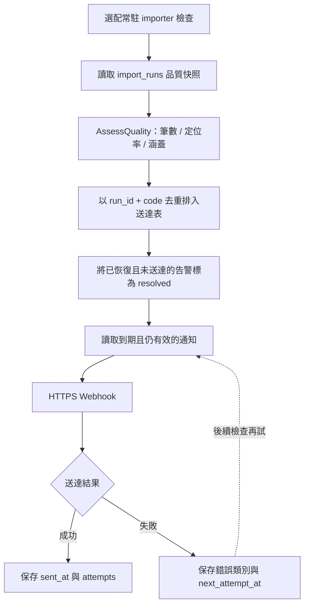
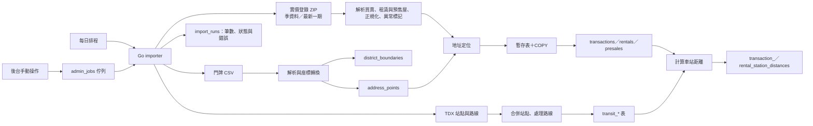

# 實價登錄資料匯入

GeoProphet 用 importer 下載內政部實價登錄的買賣、租賃與預售屋資料，再比對地方政府公開的門牌坐標，離線定位，不需要外部 geocoding API。

回到 [文件索引](README.md)。

這份 repo 保留完整的來源下載與匯入程式，不附官方資料檔案或資料庫 dump。預設 Demo 不下載來源資料，測試使用合成 fixture。

目前支援：

| 縣市 | importer code |
| --- | --- |
| 台北市 | `a` |
| 新北市 | `f` |
| 桃園市 | `h` |

## 首次建立資料

確認[資料來源條款](DATA_SOURCES.md)，先以 `make docker` 啟動本機 Docker stack，再執行：

```bash
make import-city CITY=a SEASON=114S3-115S2
```

`import-city` 依序匯入門牌、買賣、租賃、預售屋與生活機能，也可以單獨執行「手動操作」中的指令。`CITY` 可以填多個縣市（`a,f,h`）；尚未公布的季度會略過。門牌要先匯入，交易才能定位。

這些指令會下載來源並寫入你自己的本機資料庫。預設埠號 3100 與 project `geo-prophet-public` 不連到其他專案。不要將下載檔案、備份或含帳號的 log 提交至 Git。

### Webhook 告警

若需要持續同步與品質通知，在 Bash 終端機依序輸入接收端 HTTPS URL 和 Bearer token（不需 token 時直接按 Enter）：

```bash
read -r QUALITY_WEBHOOK_URL
read -rs QUALITY_WEBHOOK_TOKEN
export QUALITY_WEBHOOK_URL QUALITY_WEBHOOK_TOKEN
docker compose run --rm \
  -e QUALITY_WEBHOOK_URL -e QUALITY_WEBHOOK_TOKEN \
  -e TDX_CLIENT_ID -e TDX_CLIENT_SECRET \
  importer sync -city a -interval 24h -facility-max-age 0
unset QUALITY_WEBHOOK_URL QUALITY_WEBHOOK_TOKEN
```

這個指令也會同步資料，不是只檢查告警。啟動後會立即同步台北市門牌、最新已公布季度與本期交易，之後每 24 小時同步一次，不會自動回補全部歷史季度。

範例略過設施更新。需要軌道更新時，先依 [TDX 金鑰](#tdx-金鑰) 讀入並 export TDX 憑證，執行結束後再 unset。按 Ctrl+C 停止，不會刪除資料庫。

沒有設定 `QUALITY_WEBHOOK_URL` 時，只在後台顯示告警，不對外發送。
常駐 importer 在同步後及每 5 分鐘檢查一次，同一匯入執行與告警規則只排一次。

通知以 `POST` 發送 JSON `{"event":"geo-prophet.quality-alert","alert":{...}}`；若設定 token，會帶 `Authorization: Bearer ...`。遠端只允許 HTTPS，本機測試可用 loopback HTTP。

傳送失敗會退避重試，直到成功；告警恢復後，未送出的舊事件就不再發送。若傳送成功後、記錄成功前程序中斷，可能重送一次，因此接收方應以 `alert.runId` 加 `alert.code` 去重。



重試間隔從 60 秒開始，最長一小時。

原始碼入口：[品質規則](../api/internal/usecase/quality.go)、[送達協調](../api/internal/usecase/quality_webhook.go)、[持久化與退避](../api/internal/infra/postgres/quality_alerts.go)。

告警規則與門檻見 [API 文件](API.md#資料同步狀態)。告警用來提醒檢查資料來源與匯入流程；十日一期筆數下降，不代表實際成交量也下降。

## 資料完整度

季資料在該季結束後才公布，中間靠每 10 日一期的本期資料補上。來源網站只提供最新一期，錯過的期數要等下一季季資料公布才能補齊。

API 依 `import_runs` 計算登錄資料連續涵蓋到哪一天，再保留 90 天登錄延遲，判斷哪些月份已完整。趨勢圖以虛線標示未完整月份，年增率只比較完整月份，計算方式見 [API 文件](API.md)。

常駐 importer 每天同步，可降低錯過本期資料的風險；但若停機跨過一期，來源只保留最新一期時，無法從該來源自動補回已下架的期數，須等後續季資料公布。

## 自動同步

公開 Compose 不啟動常駐 importer。上面的 `importer sync -interval 24h` 會依同樣規則：門牌坐標超過 30 天才更新、匯入最新已公布的季資料與最新一期、軌道站點超過 7 天才更新、生活機能每個來源超過 30 天才更新。每個步驟都可安全重跑，已完成的工作依 `import_runs` 跳過。

## 手動操作

以下指令各自下載一種來源，寫入本機資料庫。

### 更新門牌坐標

```bash
make import-addresses CITY=a,f,h
```

### 重算行政區範圍

```bash
docker compose run --rm importer boundaries -city a,f,h
```

行政區比較頁的地圖使用 `district_boundaries`。更新門牌坐標時會自動重算，一般不需手動執行。

### 更新大眾運輸站點

```bash
make import-transit
```

需要 TDX 金鑰，見[大眾運輸站點](#大眾運輸站點)。

### 匯入歷史季度

```bash
make import-sales SEASON=105S1-115S2 CITY=a,f,h
make import-sales SEASON=115S2 CITY=a
```

`SEASON` 使用民國年與季別，可接受範圍或逗號分隔。季資料按「登記日期」分季，例如 `115S2` 代表民國 115 年 3 月 11 日至 6 月 10 日登記的案件。

### 匯入租賃

```bash
make import-rentals SEASON=101S4-115S3 CITY=a,f,h
```

只匯入租賃，不重跑買賣。租賃自 101S4 起才有資料；三市全部回補約 46 萬筆，約需 3 分鐘，主要花在下載。自動同步會同時匯入買賣、租賃與預售屋。

### 匯入預售屋

```bash
make import-presales SEASON=101S4-115S3 CITY=a,f,h
```

只匯入預售屋，三市全部回補約 27 萬筆，約需 3 分鐘。

### 匯入生活機能設施

```bash
make import-facilities                 # 全部來源
make import-facilities SOURCE=nhi,moe  # 只更新健保與學校名單
```

OpenStreetMap 台灣全區檔約 330 MB，從伺服器下載約需 10–40 分鐘，解析約 15 秒；健保與學校名單約 1 分鐘。

### 匯入最新一期

```bash
make import-current CITY=a,f,h
```

### 不使用 Docker

```bash
cd api
DATABASE_URL='postgres://...' go run ./cmd/importer sales -season 115S2 -city a
```

傳入 `-file` 可改讀已下載的本機檔案。

## 處理流程



圖中三種來源依更新週期或手動要求執行，並非每次同步都重新下載。失敗會記錄在 `import_runs`，符合重試條件的工作由下次排程再試；後台的手動工作另外記錄在 `admin_jobs`。

1. `importer addresses` 透過 data.gov.tw 找到最新門牌坐標 CSV。
2. 合併同門牌的樓層資料，將 TWD97 TM2 坐標轉為 WGS84。
3. `importer sales`／`rentals`／`presales` 下載並解析實價登錄 zip，正規化文字、價格、租金與坪數。
4. 依序嘗試門牌、同巷弄最近門牌、路段中心、行政區中心定位。
5. 透過 PostgreSQL COPY 寫入 staging table，再以實價登錄「編號」upsert。
6. 將來源、結果、筆數、略過原因與定位精度寫入 `import_runs`。

COPY 的 staging table 只存在於當次資料庫交易，**不是持久的原始資料層**。下載的 ZIP、CSV 與 TDX 回應目前不會長期保存。

要用新版解析規則重跑，需重新下載仍可取得的來源；門牌／實價登錄匯入也可用 `-file` 指定先前自行保存的檔案。

## 行政區範圍

官方鄉鎮市區界線（[data.gov.tw/dataset/7441](https://data.gov.tw/dataset/7441)）只允許台灣 IP 下載，部署主機在台灣以外無法取得，因此行政區範圍由門牌坐標推算（`api/internal/districtmap`）：

1. 每個 H3 resolution 8 六角格（約 0.7 km²）歸給格內門牌最多的行政區；門牌少於 3 個的格子略過，避免零星定位誤差形成飛地。
2. 同一行政區的格子合併成多邊形，移除內部孔洞（公園、河道等沒有門牌的區域），並略過另有大片區域的單格孤島。

邊界因此呈六角格狀，沒有門牌的山區與水域不會被涵蓋，適合著色地圖與判斷位置所屬行政區，不適合做精確的地籍用途。

同一季可重複匯入；官方更正會以相同編號覆寫舊資料。最新一期資料之後也會被正式季度資料校正。

## 大眾運輸站點

`importer transit` 從交通部 [TDX 運輸資料流通服務](https://tdx.transportdata.tw) 下載台北、新北、桃園的捷運、輕軌、台鐵與高鐵站點、出入口與路線（`api/internal/transit`）：

| 系統 | TDX 營運單位 |
| --- | --- |
| 捷運 | `TRTC` 臺北捷運、`NTMC` 新北捷運（環狀線、三鶯線）、`TYMC` 桃園機場捷運 |
| 輕軌 | `NTDLRT` 淡海輕軌、`NTALRT` 安坑輕軌 |
| 台鐵 | `TRA`（v3 API） |
| 高鐵 | `THSR` |

### TDX 金鑰

TDX 需要會員的 API 金鑰；未帶金鑰每個 IP 每天只能呼叫幾十次，不足一次匯入所需的約 30 次。免費會員每分鐘可呼叫 5 次，importer 依回應的 `RateLimit-Remaining`／`RateLimit-Reset` 自動等待，因此一次匯入約需 7 分鐘；站點每 7 天才更新一次，不會碰到上限。

1. 在 <https://tdx.transportdata.tw> 註冊會員，於「會員中心 → 資料服務 → API 金鑰」建立一組金鑰。
2. 在 Bash 終端機依序輸入 client ID 和 client secret（secret 不會顯示），再匯入：

   ```bash
   read -r TDX_CLIENT_ID
   read -rs TDX_CLIENT_SECRET
   export TDX_CLIENT_ID TDX_CLIENT_SECRET
   make import-transit
   unset TDX_CLIENT_ID TDX_CLIENT_SECRET
   ```

   公開 Compose 只替 importer 設定 `DATABASE_URL`；TDX 與 Webhook 變數即使寫在 `.env`，也不會自動傳入容器，需像上例以 `-e` 明確傳入。不要把金鑰放在指令參數、前端變數或 Git 裡。

`TDX_BASE_URL` 可改變 API 位址，預設 `https://tdx.transportdata.tw/api/basic`。

### 處理方式

1. 只保留三個縣市內的站點；台鐵的虛擬站（如「臺北-環島」）略過。
2. 同名（臺／台、「站」「車站」字尾視為相同）且相距 800 公尺內的月台合併為一站；不同營運單位且相距 150 公尺內的月台即使名稱不同也合併，例如機場捷運「高鐵桃園站」與高鐵桃園站。
3. 出入口作為車站的進出點；輕軌沒有出入口資料，以月台位置代替。
4. 台鐵與高鐵路線裁切到站點範圍外約 3 公里。
5. 計算每筆交易到各車站最近出入口的直線距離，保留 800 公尺內的配對（`transaction_station_distances`）。只計入定位到門牌（`address`、`nearby`）的交易；路段或行政區中心的位置誤差太大。

站點、路線與距離在同一個交易中整批替換，下載完成後重算距離約需 1 分鐘。之後匯入的實價登錄資料會在寫入時一併計算距離。

### 通車日期

TDX 沒有通車日期，因此 2015 年以後通車的路線與車站記錄在資料表 `transit_openings`，每筆附來源。新路線或新站通車時，在後台的「通車日期」頁（`/admin/openings`）補上：路線填在路線列表，比所屬路線晚通車的車站加為例外車站。未記錄的路線與車站視為 2015 年前通車。

儲存後立即由 SQL 函式 `refresh_transit_openings()` 重算路線、月台與車站的通車日期，不需重新匯入；重新匯入軌道站點後也會呼叫同一函式，因此規則只有一處。初始資料來自 migration `000011_transit_openings.sql`。

## 定位精度

`transactions.geocode_precision`：

| 值 | 說明 | 地圖點位／H3 | 趨勢 |
| --- | --- | --- | --- |
| `address` | 完整門牌 | 包含 | 包含 |
| `nearby` | 同巷弄最近門牌 | 包含 | 包含 |
| `road` | 路段中心 | 包含 | 包含 |
| `district` | 行政區中心 | 排除 | 包含 |

實價登錄可能用 Unicode 私用區字元表示難字。比對路名時 importer 將其視為萬用字元，而且只接受唯一候選，避免錯誤配對。

## 租賃資料

租賃與買賣在同一個季度 ZIP（`<city>_lvr_land_c.csv`），寫入 `rentals` 表，`import_runs` 的資料集為 `rentals`／`rentals_release`。定位與車站距離（`rental_station_distances`）的計算方式與買賣相同。

- **只有部分租約**：依法只有透過不動產經紀業（仲介）或租賃住宅服務業（包租代管）的租約須登錄，房東自租的不在資料中。新北與桃園約 65%、台北約 35% 的租約來自社會住宅包租代管。
- **社會住宅**：`social_housing` 依「租賃住宅服務」欄或備註判斷。同區、同型態、15–35 坪的租約中，社宅租金低約 15%，分析預設排除。112S4 以前沒有這個欄位，只能從備註辨識，標記率明顯偏低（新北約 43%，之後約 78%）；因此排除社宅的租金走勢從 2023-12 起，近 12 個月的統計不受影響。
- **出租型態**：112S4 起才有「出租型態」等 6 個欄位。之前的租約以面積至少 15 坪、備註未提到部分出租或套房／雅房推定為整戶出租（`whole_unit_inferred`）；以 112S4–115S2 有型態的租約驗證，這個規則約 92% 與實際相符，主要把獨立套房誤判為整戶。
- **特殊租約**：部分面積出租（`partial_area`，套房與雅房的面積常與租金不對應）、多個門牌（`multiple_units`）、期間內租金不同（`variable_rent`）、親友間租賃，以及整戶租約中每坪租金超出同區四分位距 3 倍的極端值（`price_outlier`）。續租另記為 `renewal`，租金通常落後行情。
- **每坪租金**：月租金減去另計的車位租金，除以建物總面積減車位面積。許多租約的車位含在租金內未分開計價。

## 預售屋資料

預售屋在同一個季度 ZIP（`<city>_lvr_land_b.csv`），欄位與買賣相同，另有建案名稱、棟及號（約 108 年起）與解約情形（約 113 年起，例如 `1150329全部解約`），寫入 `presales`，`import_runs` 的資料集為 `presales`／`presales_release`。季資料會回填後來的解約，重新匯入時以「編號」更新。

- **登錄制度**：110S3（2021 年 7 月）以前，預售屋在代銷合約結束後才整批登錄，延遲 1–4 年；之後改為簽約 30 日內登錄。
- **位置**：地址常只到路或巷（例如「新生北路二段68巷」），早期還有地號；約 38% 的建案有門牌號。「共13筆」這類後綴會先去除再定位。建案位置取該案最精確的一筆（`presale_projects`，由 `refresh_presale_projects()` 在每次匯入後重建）。
- **建案名稱**：原始資料中無法編碼的字以「?」呈現（例如「衡?」），無法還原。
- **統計**：解約（`is_cancelled`）與特殊交易不計入建案統計。

## 社區

實價登錄的中古屋成交沒有社區名稱，因此用成交資料推算：同一縣市、同一路段（含巷弄）、同一完工日的住宅大樓、華廈與公寓門牌歸為一個社區。規則與欄位見 [HTTP API](API.md#社區大樓)。

- **分組**：`transactions` 與 `rentals` 的 `community_key` 是 generated column，由 `community_key()` 從地址、建物型態與完工日算出，匯入時自動產生。地址先去除空白與行政區後的里鄰（`clean_address()`），`121-1號` 視為 `121之1號`。
- **社區表**：`communities` 每個社區一列（門牌、最常見型態、最高樓層、成交數、位置）。`UpsertTransactions` 在同一個交易裡以 `refresh_communities()` 重建這批成交新舊所屬的社區，所以修正後換了社區的成交也會更新。
- **名稱**：`name_communities()` 以行政區為範圍，把預售建案名稱配給互為最佳配對的社區；匯入預售屋後會重新配對該建案所在行政區。預售屋地址常是交叉口、棟別戶別（`元富一街A1-15F`）或地號，`address_streets()` 從中取出每一條路（含段、巷、弄），配對時也比較建案最高樓層（`total_floors`）與社區最高樓層。`presale_projects` 因此多存 `door_number`、`streets`、`first_contract`、`presales` 與 `total_floors`（migration `000020`）。
- **規模**：台北、新北、桃園共約 8.7 萬個社區，其中約 2 萬個有 10 筆以上成交，約 1,750 個配到建案名稱；2022 年以後完工、10 筆以上成交的大樓與華廈約六成有名稱。
- **限制**：同一路段同一天完工的不同建物會合併；同一社區若各棟完工日不同會分開；建案名稱配對是推算，少數可能配錯或配到同期的另一棟。

## 生活機能設施

`facilities` 依來源整批替換，`import_runs` 的資料集為 `osm_facilities`、`nhi_facilities`、`moe_schools`：

- **OpenStreetMap**（Geofabrik 台灣全區檔）：便利商店、超市、傳統市場、公園、圖書館與嫌惡設施（加油站、變電所、殯葬設施、墓地、垃圾轉運站與掩埋場）。標記的點直接使用；封閉的線（例如公園）取中心點並保留範圍與面積；多邊形關聯（relation）略過。依門牌坐標推出的 H3 行政區歸屬判斷縣市與行政區，三市以外的設施捨棄。OSM 由志工維護，便利商店與超市相當完整，變電所與垃圾設施可能缺漏。資料採 ODbL 授權，使用時須標示「© OpenStreetMap contributors」。
- **健保特約醫事機構**（醫學中心、區域醫院、地區醫院、診所）：OSM 的診所不到實際的兩成，因此改用健保名單。以門牌定位，只保留定位到門牌或同巷附近者（約 96%）。
- **教育部學校名錄**（國小、國中、一般高中、大專）：取最新學年度，以門牌定位，約 92% 定位成功。OSM 的學校標記混雜補習班等，不採用。

沒有統一的學區開放資料，因此只提供到最近學校的距離，不代表學區。

## 特殊交易與統計

親友交易、分件登記、極端價格與日期異常會保留在資料庫，原因記錄在 `special_reasons`。`is_special` 是 generated column；API 預設排除特殊交易，只有 `include_special=true` 時納入。

日期異常（`invalid_date`）是成交日期晚於該季登記期間最後一天的交易：成交必定先於登記，因此這類日期是來源的輸入錯誤，例如登記於 110 年第 2 季、成交日期卻是 2101-03-03。匯入時會自動標記；migration `000009` 補標了先前匯入的資料。這類交易保留原始日期，但不計入市場統計，社區的最近成交日也略過它們（migration `000019`）。

政府買賣（`government_sale`）包含政府標讓售、協議價購，以及向政府購得的住宅：備註含「向政府機關承購／申購」（例如合宜住宅）、「區段徵收專案配售」、「安置住宅」或「眷村改建」。這類成交遠低於行情，例如 2017 年北投文林北路75巷的區段徵收配售每坪 24–28 萬，未排除時會把北投當年住宅大樓中位數從約 56 萬拉低到 27 萬。只寫「國宅」或「國民住宅」的成交多是轉手，價格接近行情，不列入；只有「土地及建物分次登記」也不列入。migration `000018` 補標了先前匯入的資料。

每坪單價以建物價除以建物坪數計算，車位價格與車位坪數均排除。

## 新增支援縣市

1. 在 `api/internal/addresspoint/sources.go` 加入 data.gov.tw dataset ID、縣市代碼與坐標格式。
2. 用真實 CSV 驗證行政區碼、TWD97 zone 與地址欄位；各縣市格式不完全相同。
3. 補 address parser、坐標轉換與 matcher 測試。
4. 用小範圍 season 執行匯入，檢查 `import_runs` 的定位精度分布。

## 資料來源

資料採政府資料開放授權條款第 1 版：

- [不動產成交案件實際資訊](https://plvr.land.moi.gov.tw/DownloadOpenData)
- [臺北市門牌位置數值資料](https://data.gov.tw/dataset/155472)
- [新北市門牌位置數值資料](https://data.gov.tw/dataset/168887)
- [桃園市門牌位置坐標資料](https://data.gov.tw/dataset/157689)
- [TDX 運輸資料流通服務](https://tdx.transportdata.tw)（軌道站點、出入口與路線）
- [OpenStreetMap](https://www.openstreetmap.org/copyright)（經 [Geofabrik](https://download.geofabrik.de/asia/taiwan.html)，ODbL 授權）：商店、公園與嫌惡設施
- [健保特約醫事機構](https://data.gov.tw/dataset/39283)：醫院與診所
- [教育部各級學校名錄](https://data.gov.tw/dataset/6087)：學校

## 合成測試資料

```bash
make fixtures
cd api
go test ./internal/lvr ./internal/importer ./internal/transit
```

CSV 是依 parser 測試情境手工建構：主鍵使用 `SYN-*`，道路與建案使用示範名稱；刻意保留停車、土地、特殊交易、缺失日期、社宅與解約案例。金額只是數值運算測試，不代表行情。測試 ZIP 在記憶體生成。TDX loader 使用合成 getter，沒有保存官方回應。

開發版使用真實 TDX fixture 的相容性測試沒有匯出，因此兩個版本的測試覆蓋不完全相同。公開版改用合成 loader 測試，檢查解析和來源錯誤，沒有驗證所有官方站點。

## 已知限制

- 實價登錄通常延遲 1–3 個月揭露，最近月份筆數偏少不代表成交量立即下降。
- 初次回補大量季度時會占用較多網路、CPU 與資料庫 I/O，建議分批執行並觀察 `import_runs`。
- 最早期季度只有部分縣市；下載不到的縣市會略過並留下紀錄。
- 行政區範圍為門牌推算的近似值，邊界呈六角格狀，山區與水域可能空白。
- 車站距離為到出入口的直線距離，不是實際步行距離。
- 生活機能距離為直線距離，不是步行距離；OSM 的嫌惡設施可能不完整。
- 預售屋位置多只到路段，110S3 以前的資料為延遲整批登錄，見「預售屋資料」。
- 租賃資料只涵蓋經業者或仲介的租約，且 112S4 以前的整戶出租為推定值，見「租賃資料」。
