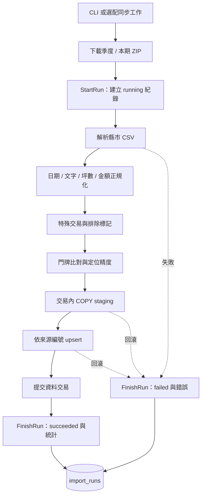
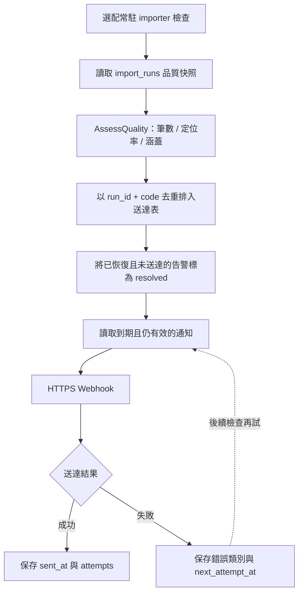

# Data Pipeline

本公開版包含完整來源下載與匯入程式，但不包含官方資料檔案或資料庫 dump。預設 Demo 不下載任何來源資料，測試使用合成 fixture。

## 實價登錄匯入主路徑



本圖以實價登錄匯入為例，不代表所有來源都走 CSV 或 upsert：門牌、設施與軌道資料有整批替換路徑。ZIP 下載／開啟發生在逐縣市 `StartRun` 前，因此下載失敗不保證已有該批的 `import_runs`；已啟動的批次才由 `FinishRun` 記錄結果。定位失敗可計入統計，不一定使整批失敗。staging 是暫存寫入機制，不是持久 raw layer。

原始碼入口：[匯入服務](../api/internal/importer/service.go)、[COPY 與寫入](../api/internal/infra/postgres/import_store.go)、[地理定位](../api/internal/geocode/matcher.go)。

## 品質告警與重試



退避由 60 秒起，最長一小時。接收成功後、`sent_at` 保存前若程序中斷，通知可能重送；接收端應依 `run_id + code` 去重，不宣稱 exactly-once。未設定 Webhook 不對外通知，公開 Compose 預設也不啟動常駐 importer。

原始碼入口：[品質規則](../api/internal/usecase/quality.go)、[送達協調](../api/internal/usecase/quality_webhook.go)、[持久化與退避](../api/internal/infra/postgres/quality_alerts.go)。

## Existing behaviours

實價登錄買賣、租賃與預售透過 CSV parser 轉換日期、坪數與價格，分離車位金額，標記特殊交易。門牌由 TWD97 TM2 轉 WGS84，定位依門牌、附近門牌、路段或行政區中心逐級退回，保留精度以供分析篩選。

`importer` 下載官方季度 ZIP 或十日一期，透過 PostgreSQL COPY staging，再依編號 upsert。季資料可以覆寫先前的本期資料。每縣市／資料集的結果保留於 `import_runs`；寫入筆數包含覆寫，不等於新成交數。原始下載檔案尚未持久保存，不能依此宣稱 raw replay。

完整實作包含可選的常駐同步（門牌、季資料、本期與軌道更新）、人工工作認領與品質通知。公開 Compose 不預設啟動這些工作，也不提供 TDX／Webhook 憑證。

## Synthetic fixture verification

```bash
make fixtures
cd api
go test ./internal/lvr ./internal/importer ./internal/transit
```

CSV 是依 parser 測試情境手工建構：主鍵使用 `SYN-*`，道路與建案使用示範名稱；刻意保留停車、土地、特殊交易、缺失日期、社宅與解約案例。金額只是數值運算測試，不代表行情。測試 ZIP 在記憶體生成。TDX loader 使用合成 getter，沒有保存官方回應。

原開發版的 TDX 真實 fixture 相容性測試未匯出，因此公開與開發版的測試覆蓋不完全相同。替代的合成 loader 測試驗證解析與來源錯誤，不宣稱驗證所有官方站點。

## Optional real data import

確認 [資料來源條款](DATA_SOURCES.md)，先啟動本機 Docker stack，再執行：

```bash
docker compose run --rm importer addresses -city a
make import-sales SEASON=115S2 CITY=a
make import-rentals SEASON=115S2 CITY=a
make import-presales SEASON=113S3 CITY=a
```

上述指令會下載來源並寫入你自己的本機資料庫。預設埠號 3100 與 project `geo-prophet-public` 不連到其他專案。不要將下載檔案、備份或含帳號的 log 提交至 Git。

## Quality interpretation

品質檢核以批次筆數、定位率、前一期比較與匯入涵蓋為依據，不代表來源所有案件已揭露。流動性 API 的零筆月可能是匯入缺口；樣本不足或涵蓋不足時衍生指標回傳 `null`。通知可能重送，接收方應以 run ID 和告警代碼去重。
